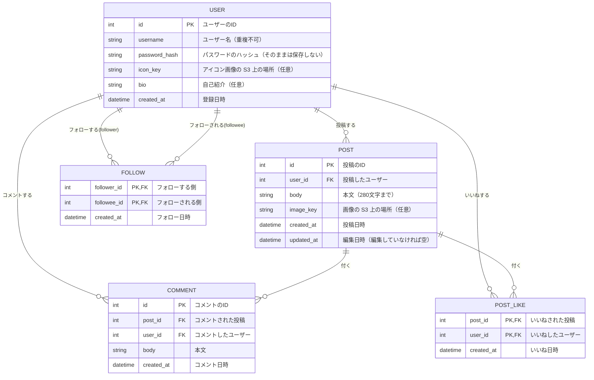

# データ設計

アプリが保存するデータの構造を定める。
1〜2は、データベースの種類に依らない概念レベルの設計。実際の型や名前は、あとで「実装での具体化」に記す（[技術スタック](tech-stack.md) を参照）。

> **状態：ドラフト（2026-11-13）。** 未決の点が決まったら、見直す。「【未決】」は、決まっていない点。

## 1. ER 図

## 2. データの説明

### 2.1 ユーザー（USER）
| 項目 | 内容 | 必須 | 関連する機能 |
|---|---|---|---|
| username | ユーザー名。重複できない。文字数・使える文字は【未決】 | 必須 | 登録、ログイン、検索、表示 |
| password_hash | パスワードを、変換（ハッシュ化）した物。元のパスワードは保存しない | 必須 | ログイン |
| icon_key | アイコン画像の、S3 上の場所。未設定の場合は空（初期画像を表示） | 任意 | プロフィール |
| bio | 自己紹介。文字数は【未決】 | 任意 | プロフィール |
| created_at | 登録した日時 | 必須 | — |

【未決】メールアドレスの項目を持つか（ログインの ID に使うか）。

### 2.2 投稿（POST）
| 項目 | 内容 | 必須 | 関連する機能 |
|---|---|---|---|
| user_id | 投稿したユーザー | 必須 | 投稿、プロフィールの投稿一覧、編集・削除の権限 |
| body | 本文（280 文字まで） | 必須 | 投稿 |
| image_key | 画像の、S3 上の場所。複数枚にするかは【未決】（複数枚なら、別の表に分ける） | 任意 | 画像投稿 |
| created_at | 投稿日時。タイムラインの並び順（新しい順）に使う | 必須 | タイムライン |
| updated_at | 編集した日時。「編集済み」の表示に使う（【未決】表示するか） | 任意 | 編集 |

- **削除**：本当にデータを消すか、消したことにする（論理削除）かは【未決】。削除した投稿の、コメント・いいね・画像の扱い（一緒に消す、など）も【未決】

### 2.3 コメント（COMMENT）
| 項目 | 内容 | 必須 | 関連する機能 |
|---|---|---|---|
| post_id | コメントされた投稿 | 必須 | コメント |
| user_id | コメントしたユーザー | 必須 | コメント、プロフィールへの移動 |
| body | 本文。文字数は【未決】 | 必須 | コメント |
| created_at | コメントした日時 | 必須 | — |

- **コメント数**：投稿ごとの COMMENT の件数で数える（件数を投稿に持たせるかは、実装で決める）
- 【未決】コメントへの返信を作る場合は、「返信先のコメント」の項目を足す
- 投稿した本人も、自分の投稿にコメントできる（制限なし）

### 2.4 いいね（POST_LIKE）
- 「どの投稿に、どのユーザーがいいねしたか」の組み合わせを、1 行で持つ。**同じ組み合わせは、1 つだけ**（同じ人が同じ投稿に、2 回いいねできない）。取り消すときは、その行を消す
- **いいね数**：投稿ごとの POST_LIKE の件数で数える
- 投稿した本人も、自分の投稿にいいねできる（制限なし）
- 【未決】コメントへのいいねを作る場合は、別の表（または対象を区別する項目）を足す

### 2.5 フォロー（FOLLOW）
- 「どのユーザーが、どのユーザーをフォローしているか」の組み合わせを、1 行で持つ。同じ組み合わせは、1 つだけ。解除するときは、その行を消す
- 自分自身は、フォローできない（フォローする側とされる側が、同じ行は作れない）
- **フォロー数**：自分が follower の行の件数。**フォロワー数**：自分が followee の行の件数
- 「フォロー中」のタイムライン：自分がフォローしているユーザーの投稿（【未決】自分の投稿を含めるか）

## 3. 補足
- インプレッション（表示された回数）は、**保存しない**（作らない機能）
- リツイート（再投稿）の表は、ない（作らない機能）
- ユーザーの削除（退会）：【未決】作るか。作る場合の、投稿などの扱い
- 画像の本体は、データベースには入れず、S3 に置く。データベースには、場所（キー）だけを持つ
