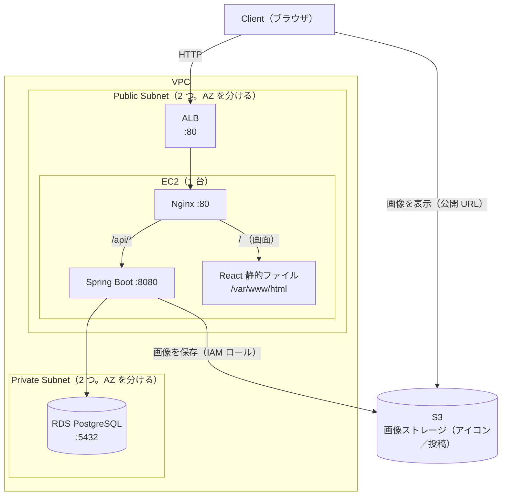

# インフラ構成（AWS）

> **状態：ドラフト（2026-11-15）。** 講義の先生の infrastructure.md をひな形に、決定（X-1・X-3・IMG-1・IMG-4）を反映した。
> 「【要確認】」は、環境構築・Terraform の段階で確かめる点。「【補足】」は、Claude Code が補った提案（ユーザーの確認待ち）。
> 全体は [要件定義](requirements.md) を参照。

## 1. 構成概要

### 設計方針
- AWS 上に、EC2 + RDS + ALB + S3 の構成でデプロイする
- ALB を前段に置き、EC2 へ通信を渡す（X-1。2026-11-15 決定）
- 画像ファイルは S3 に保存する。**バックエンドを通して**保存する（IMG-4）。画像用のバケットは**公開**する（IMG-1）
- EC2 上で、Nginx + Spring Boot（バックエンド）+ React（フロントエンドの静的ファイル）を同居させる
- **NAT Gateway は使わない**（費用が大きく、RDS は外へ出る必要がないため）
- **学習中は HTTP**（X-3。2026-11-15 決定）。あとで HTTPS にできる形にしておく（7 を参照）

### 構成図


- S3 は、VPC の外にある（AWS 全体の保管庫）
- ALB と RDS の Subnet グループは、AWS の決まりで、2 つ以上の AZ（データセンターの区画）が要る。そのため、Subnet は Public・Private とも 2 つ。**EC2 と RDS の本体は、1 台ずつ**

## 2. AWS サービス一覧
| サービス | 用途 | スペック |
|---|---|---|
| VPC | ネットワーク分離 | カスタム VPC |
| EC2 | アプリケーションサーバー | t2.micro（Amazon Linux 2023）【要確認】 |
| RDS | データベース | db.t4g.micro（PostgreSQL 18。TaskManagement と同じ版）【要確認：RDS で、この版が使えるか】 |
| ALB | ロードバランサー | Application Load Balancer。**使い終わったら `terraform destroy` で消す** |
| S3 | 画像ストレージ | Standard。画像用のバケットだけ公開（IMG-1） |
| IAM | アクセス制御 | EC2 用ロール（S3 への保存・削除の権限だけ） |

- **使わない物**：NAT Gateway（X-1）、HTTPS 用のドメイン・証明書（X-3。あとで足せる）

## 3. EC2 サーバー構成
| 項目 | 技術 | バージョン |
|---|---|---|
| OS | Amazon Linux 2023 | 最新 |
| 言語 | Java（OpenJDK） | 25 |
| ランタイム | Node.js | 24（ビルド用。サーバーで画面をビルドするか、手元でビルドして置くかは【要確認】） |
| Webサーバー | Nginx | 最新 |

## 4. Nginx 構成
### リバースプロキシ設定
- `/api/*` → Spring Boot（localhost:8080）にプロキシ
- `/` → React 静的ファイルを配信
- 画面側でページを切り替えるため、存在しないパスは `index.html` にフォールバック

### ディレクトリ構成（EC2 上）
```
/var/www/html/              # React ビルド成果物
/opt/app/                   # Spring Boot jar ファイル
/etc/nginx/conf.d/          # Nginx 設定ファイル
/etc/systemd/system/        # systemd サービス定義
```

### systemd サービス
- `raisetimeline.service`：Spring Boot アプリケーション（サーバーが再起動しても、自動で立ち上がる）

## 5. セキュリティ
### ポートとアクセス元
| ポート | プロトコル | アクセス元 | 用途 |
|---|---|---|---|
| 80 | HTTP | **インターネット（`0.0.0.0/0`）→ ALB** | 利用者の入口。**`0.0.0.0/0` を入口に書くのは、ALB のこの 1 か所だけ**（ユーザー承認済み。2026-11-15） |
| 80 | HTTP | ALB のセキュリティグループ → EC2（Nginx） | ALB から Nginx へ |
| 8080 | HTTP | localhost のみ | Spring Boot（外へ出さない） |
| 5432 | TCP | EC2 のセキュリティグループのみ → RDS | データベース |
| 22 | SSH | 管理者の IP（`/32`）のみ | サーバーの管理【要確認：SSM を使えば、22 を開けずに済む】 |

- EC2・RDS の入口は、**自分の IP（`/32`）か、ALB・EC2 のセキュリティグループだけ**（CLAUDE.md 5）
- RDS は Private Subnet に置き、インターネットから直接つながらない
- S3：画像用のバケットだけ公開する。**公開は「読む」だけ**で、書き込み・削除は、EC2 の IAM ロールだけができる。ファイル名は UUID（IMG-1）
- **秘密（DB のパスワード、JWT の署名の鍵、AWS のキー）は、リポジトリに入れない**（CLAUDE.md 4）

## 6. Terraform ディレクトリ構成（予定）
```
terraform/
├── main.tf          # プロバイダー・全体
├── variables.tf     # 変数の定義
├── outputs.tf       # 出力
├── network.tf       # VPC・Subnet・ルート【補足】
├── security.tf      # セキュリティグループ【補足】
├── ...              # EC2、RDS、ALB、S3、IAM（作りながら決める）
└── terraform.tfvars # 実際の値（コミットしない）
```
- ファイル名・分け方は、作りながら決める（先生の構成を参考に）。`terraform.tfvars`・`*.tfstate`・`*.tfplan` は、コミットしない
- **`terraform apply` と `destroy` は、ユーザーが承認するまで実行しない**。先に `plan` を説明する（CLAUDE.md 5）

## 7. 費用と運用
- **費用がかかる物は、使い終わったら `destroy` で消す**。消したあと、残っていないか確かめる。**ALB は、動かしている間ずっと課金される**ので、特に注意する
- NAT Gateway は使わない（X-1）
- **HTTPS（X-3）**：学習中は HTTP のまま。**本物のパスワード・個人情報は入れない**（架空のデータだけで確認する）。あとで HTTPS にするときは、ドメイン + ACM（証明書）を用意し、ALB に 443 を足す。講義で出たら、ユーザーと相談する
- AWS へのデプロイは、作る順番の⑥（[機能一覧](features.md) の X-2）。ローカルでは、S3 の代わりの保存先が要る（画像の段階で決める）

## 8. 画像（S3）の扱い
- アイコン・投稿の画像は、バックエンドが S3 に保存する。データベースには、場所（キー）だけを持つ（[03 画像](features/03-image.md)）
- EC2 は、IAM ロールで S3 を操作する（アクセスキーを、サーバーに置かない）
- 古いアイコンの削除は、新しい画像の保存に成功してから行う（IMG-5）
