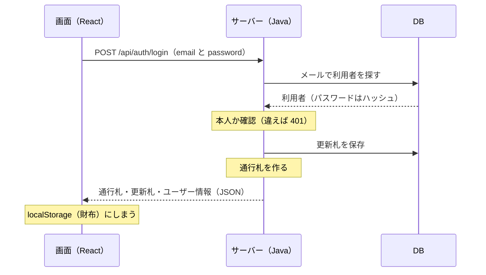

# ログインの道すじ：画面 → サーバー → DB → 画面を、ファイルと行で追う

2026-11-25〜27 の復習。[ノート 35](35-review-g.md) で「画面とサーバーの分担がピンと来ない」と感じた所を、入力から 1 本の道すじで追い直した。行番号は、2026-11-27 時点。ずれたら、「目印の言葉」を `Ctrl + Shift + F` で探す。

**ひとことで：サーバーが札を作り、画面がしまう。**

## 1. 全体の図

## 2. 行き（画面 → DB）

| 順 | ファイルと行 | 目印の言葉 | すること |
|---|---|---|---|
| 1 | [LoginPage.tsx:37](../frontend/src/pages/LoginPage.tsx#L37) | `await login(email, password)` | 入力した 2 つを渡す |
| 2 | [useAuth.ts:17](../frontend/src/auth/useAuth.ts#L17) | `useAuth` | `login` を取り出す入口（LoginPage.tsx の 15 行目で受け取る） |
| 3 | [AuthContext.tsx:18-19](../frontend/src/auth/AuthContext.tsx#L18-L19) | `loginApi(email, password)` | 取り次ぐ。`loginApi` は、auth.ts の `login` に、2 行目で付けた別名 |
| 4 | [auth.ts:41-42](../frontend/src/api/auth.ts#L41-L42) | `'/api/auth/login'` | 行き先を決める |
| 5 | [auth.ts:21-28](../frontend/src/api/auth.ts#L21-L28) | `fetch(path, …)` | サーバーへ送る |
| 6 | [AuthController.java:20](../backend/src/main/java/com/example/raisetimeline/auth/AuthController.java#L20) と [35-37](../backend/src/main/java/com/example/raisetimeline/auth/AuthController.java#L35-L37) | `"/api/auth"` ＋ `"/login"` | 受付 |
| 7 | [AuthService.java:66-67](../backend/src/main/java/com/example/raisetimeline/auth/AuthService.java#L66-L67) | `userMapper.findByEmail` | 調理係が、利用者を探しに行く |
| 8 | [UserMapper.java:14](../backend/src/main/java/com/example/raisetimeline/auth/UserMapper.java#L14) | `findByEmail` | 仕事の名前だけを書いた所（メニュー） |
| 9 | [UserMapper.xml:11-12](../backend/src/main/resources/mapper/UserMapper.xml#L11-L12) | `SELECT * FROM users WHERE email = #{email}` | DB への実際のお願い（レシピ） |
| 10 | [AuthService.java:71-72](../backend/src/main/java/com/example/raisetimeline/auth/AuthService.java#L71-L72) | `matches`、`UNAUTHORIZED` | 本人か確認。違えば 401 |
| 11 | [AuthService.java:74-77](../backend/src/main/java/com/example/raisetimeline/auth/AuthService.java#L74-L77) | `new RefreshToken()`、`set…` | 更新札を用意する |
| 12 | [AuthService.java:78](../backend/src/main/java/com/example/raisetimeline/auth/AuthService.java#L78) → [RefreshTokenMapper.xml:6-9](../backend/src/main/resources/mapper/RefreshTokenMapper.xml#L6-L9) | `insert` | 更新札を DB に保存する |
| 13 | [AuthService.java:79](../backend/src/main/java/com/example/raisetimeline/auth/AuthService.java#L79) → [JwtService.java:30-39](../backend/src/main/java/com/example/raisetimeline/auth/JwtService.java#L30-L39) | `createAccessToken` | 通行札を作る |

## 3. 帰り（サーバー → 財布）

| 順 | ファイルと行 | 目印の言葉 | すること |
|---|---|---|---|
| 14 | [AuthService.java:79-80](../backend/src/main/java/com/example/raisetimeline/auth/AuthService.java#L79-L80) | `new LoginResponse(…)` | 3 つを返事の箱に詰める |
| 15 | [AuthController.java:37](../backend/src/main/java/com/example/raisetimeline/auth/AuthController.java#L37) | `return` | 受付が返す。Spring が JSON（文字）に変える |
| 16 | [auth.ts:34](../frontend/src/api/auth.ts#L34) | `res.json()` | 画面が受け取って読む |
| 17 | [AuthContext.tsx:19-20](../frontend/src/auth/AuthContext.tsx#L19-L20) | `const res`、`saveSession(res)` | しまうようお願いする |
| 18 | [tokenStorage.ts:65-69](../frontend/src/auth/tokenStorage.ts#L65-L69) | `saveSession` | 3 つを、それぞれの引き出しへ |
| 19 | [tokenStorage.ts:24-26](../frontend/src/auth/tokenStorage.ts#L24-L26) | `localStorage.setItem` | 24 行目は `write` の見出し、**実際に保存するのは 26 行目** |
| 20 | [AuthContext.tsx:21](../frontend/src/auth/AuthContext.tsx#L21) | `setUser(res.user)` | 画面を「ログイン中」にする |

## 4. 大事な発見

### 画面とサーバーは「文字」でつながる

| つなぐ物 | 画面 | サーバー |
|---|---|---|
| 行き先（URL） | auth.ts 42 行目 `'/api/auth/login'` | AuthController.java 20 行目 `"/api/auth"` ＋ 35 行目 `"/login"`（**割れて書いてある**。後ろ半分で探すと見つかる） |
| 返事の名前 | [auth.ts:15-19](../frontend/src/api/auth.ts#L15-L19) `accessToken`・`refreshToken`・`user` | [AuthDtos.java:52](../backend/src/main/java/com/example/raisetimeline/auth/AuthDtos.java#L52) 同じ 3 つの名前 |

### 返事の 3 つと、財布の引き出し

| サーバーで作る・取り出す（AuthService.java 79〜80） | 日本語 | 引き出しの定数（tokenStorage.ts 12〜14） |
|---|---|---|
| `jwtService.createAccessToken(user)` | 通行札 | `ACCESS_TOKEN` |
| `refreshToken.getToken()` | 更新札 | `REFRESH_TOKEN` |
| `UserResponse.from(user)` | ユーザー情報 | `USER_INFO` |

### 通行札の中身（JwtService.java 33〜37）
持ち主の ID（`subject`）、メールアドレス（`claim`）、作った時刻（`issuedAt`）、期限（`expiration`。15 分）、署名（`signWith`）。**パスワードは入れない**（持っている人なら中身を読めるため。署名は、書き換えを見破るためのもの）。

### ログインの 401 は、Service が返す
- `/api/auth/**` は、ルール表で `permitAll`（[SecurityConfig.java:37](../backend/src/main/java/com/example/raisetimeline/auth/SecurityConfig.java#L37)）。まだ札を持っていない人が使う入口だから。
- そのため、パスワード違いの 401 は、ルール表ではなく **AuthService.java 72 行目**が返す。
- [ノート 35](35-review-g.md) の「札が無い・偽物なら、ルール表で 401」とは、**別の止まり方**。401 を返す場所は 2 種類ある。

## 5. コードの読み方

### 呼ぶ場所と、作る場所

| | 例 | 目印 |
|---|---|---|
| 呼ぶ（使う） | `authService.login(request)` | 前に `名前.` が付く |
| 作る（定義） | `public LoginResponse login(LoginRequest request)` | 前に**型**が付く |

作る行の読み方：`public`（他のファイルからも使える）／`LoginResponse`（戻り値の型＝返す物の形）／`login`（名前）／`(LoginRequest request)`（受け取る物の形と呼び名）。

### 大文字と小文字
`AuthService`（大文字で始まる）はクラスの名前で、ファイル名と同じ。`authService`（小文字で始まる）は、その係を呼ぶ名前。小文字の `userMapper` を見たら、開くファイルは `UserMapper`。全部大文字（`ACCESS_TOKEN`・`LOGIN_FAILED`）は定数。

### 同じつづりでも、別の物（auth.ts 27 行目）
`body: JSON.stringify(body),`
- 右の `body`：21 行目で受け取った物。マウスを合わせると `(parameter) body`（引数）。
- 左の `body:`：`fetch` が用意している「送る中身」の欄。合わせると `(property) RequestInit.body`（プロパティ＝欄）。
- `:` には、「形の説明」（`path: string`）と「欄の名前: 中身」の 2 つの使い方がある。

### 今回の言葉と記号

| 言葉・記号 | 意味 |
|---|---|
| `new` | 新しく作る |
| `set…`／`get…` | 書き込む／取り出す |
| `return` | 返す |
| `throw` | 投げる＝ここで中断して断る |
| `!` | 〜でない |
| `\|\|` | または |
| `.` | 「の」 |
| `: void` | 何も返さない |
| `UNAUTHORIZED` | UN（〜でない）＋ AUTHORIZED（認められた）＝ 401 |

## 6. 探し方の道具

| 操作 | 何をする | 使う場面 |
|---|---|---|
| `Ctrl + P` | **ファイル名**で探して開く | 開きたいファイルが分かっている |
| `Ctrl + F` | **今のファイルの中**を探す | この画面の中で探す |
| `Ctrl + Shift + F` | **全部のファイルの中**を探す | どのファイルか分からない |
| マウスを合わせる | 何者かの説明が出る | 引数か、欄か、などを知る |
| クリックする | 同じ言葉に色の枠が付く | 同じ物の場所を見る |
| `F12` | **作っている場所**へ飛ぶ | `.ts`・`.tsx`。今の手元の環境は Java の拡張機能がないので、`.java` では使えない |

- 覚え方：P はファイルを開く、F は find（探す）。Shift を足すと、範囲が全部に広がる。
- `Ctrl + Shift + F` でテストや文書が多すぎるときは、「除外するファイル」に `**/*test*, **/*.md, prototype` を入れる。
- 長い名前（`passwordEncoder`・`UserMapper`・`LoginRequest`）は、手で打つとつづりを間違えやすい。コピーしてよい。

## 7. 思い出す問い

上の表を隠して、先に予想してから、ファイルを開いて確かめる。

1. LoginPage.tsx 37 行目の `login` は、次にどのファイルへ行く？ サーバーに届くまで、順に言う。
2. `'/api/auth/login'` を受け取る行は、Java のどのファイルの何行目と何行目？
3. 利用者を探す SQL は、どのファイルにある？
4. パスワードが違うとき、401 を返すのはどのファイル？
5. 通行札を作るのはどのファイル？ 更新札を DB に保存する行は？
6. ブラウザに実際に保存している行は、どのファイルの何行目？

答え

1. useAuth.ts（取り出す入口）→ AuthContext.tsx 19 行目 → auth.ts 42 行目 → 24 行目の `fetch`
2. AuthController.java の 20 行目と 35 行目
3. UserMapper.xml の 12 行目
4. AuthService.java の 72 行目
5. JwtService.java の 30 行目。AuthService.java の 78 行目
6. tokenStorage.ts の 26 行目

## 次にやること
- ブラウザの開発者ツール（F12 →「アプリケーション」→「ローカルストレージ」）で、ログインの前後に、引き出しが 3 つ増えるのを確かめる（**まだ確かめていない**）。
- 札を付けて API を呼ぶ → 401 → 更新して再送、の道すじ（流れは [ノート 35](35-review-g.md) の復習 5）を、同じ形でファイルと行で追う。
